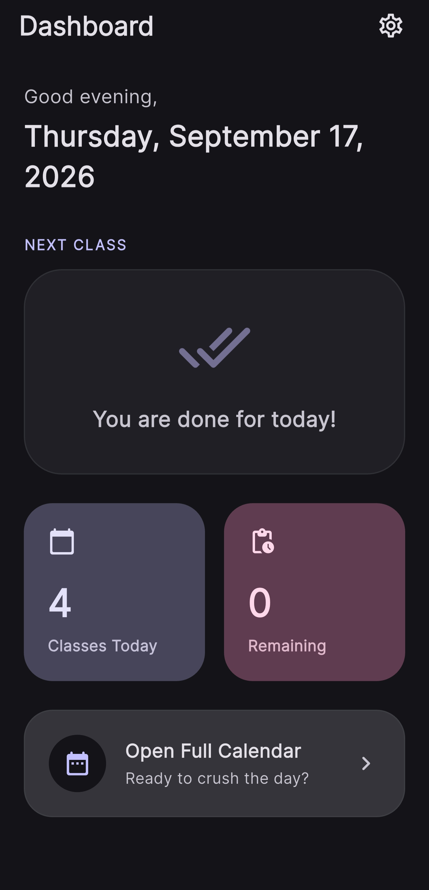
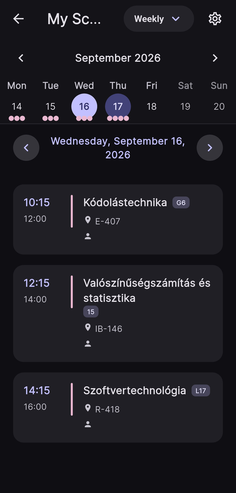
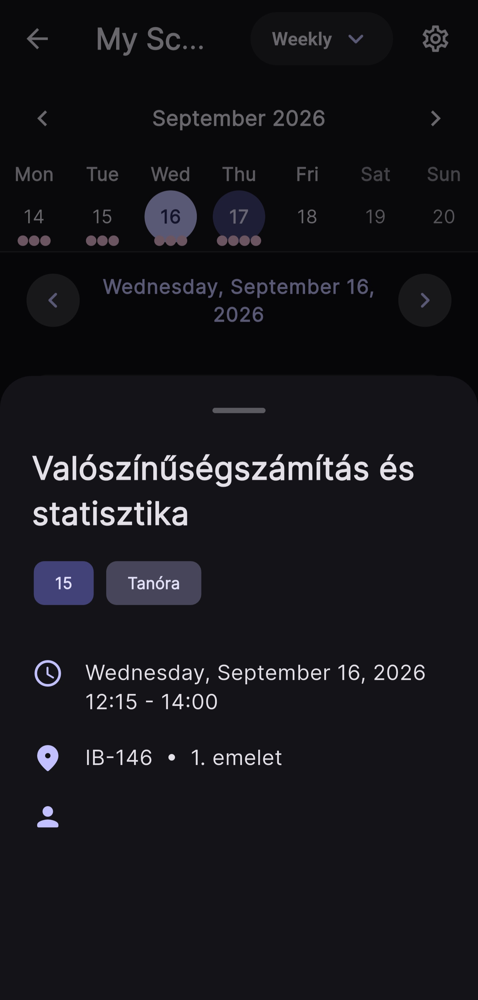
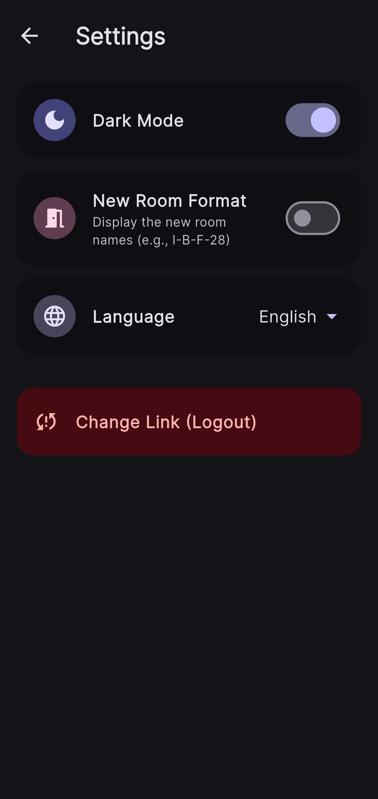

# Zsebtun

### Mobil órarend app, egyetemi Neptun tanulmányi rendszerhez.
### A modern mobile schedule application for the Neptun university system.

[]()

> [!IMPORTANT]
> ## Legal Disclaimer & Non-Affiliation Notice
> 
> **Zsebtun** is an independent, open-source project and is not an official client application.
> 
> The developers of this application are not affiliated with, endorsed by, sponsored by, or approved by **Campus Codeworks Zrt.** (formerly SDA Informatika Zrt.), the developers of the Neptun system, nor any educational institutions using it.<br>
> The "Neptun" name, logo, and related trademarks are the property of their respective owners. They are used strictly for descriptive and nominative fair use purposes to indicate system compatibility.<br>
> This application does not operate any intermediary proxy servers, nor does it collect, store, track, or share personal, authentication, or academic records with third parties. All network communication and authentication occur directly between your device and your institution's official servers over an encrypted (HTTPS) connection.<br>
> The information displayed in this application is for informational purposes only. The official web interface of your institution's Neptun portal is the sole binding and authoritative source for all academic, course, and examination data. The developers assume no responsibility or liability for any missed deadlines, registration issues, system outages, or data discrepancies.<br>

## Features

*   **Dashboard:** A sleek home screen that gives you a quick overview of your day, featuring daily class statistics and a live, calculating countdown to your next upcoming class.
*   **Interactive Calendar:** Switch between daily, weekly, and monthly views. Tap any class to open a detailed modal containing times, extracted room floors, and teachers.
*   **Offline Ready:** Your schedule is parsed and cached locally, ensuring full offline access after the initial sync.

## How It Works

1. **Export from Neptun:** Log into your university's Neptun web portal and export your calendar URL (`.ics` link).
2. **Sync in Zsebtun:** Paste the link into the app's setup screen.
3. **Enjoy:** The app downloads the raw ICS file, parses the unformatted text into clean, structured SQLite data, and displays it in a modern UI.


## Screenshots

| Dashboard | Calendar View | Class Details | Settings |
| :---: | :---: | :---: | :---: |
|  |  |  |  |

---
### Screenshots in other languages [here](https://github.com/Patesz22/Zsebtun/tree/dev/img)
---

## Getting Started

### Prerequisites
*   [Flutter SDK](https://docs.flutter.dev/get-started/install)
*   Dart SDK
*   Android Studio

### Installation
1. Clone the repository:
2. Navigate to the project directory:
3. Install dependencies:
   ```bash
   flutter pub get
   ```
4. Run the app:
   ```bash
   flutter run
   ```

## License

[MIT License](LICENSE)

---
